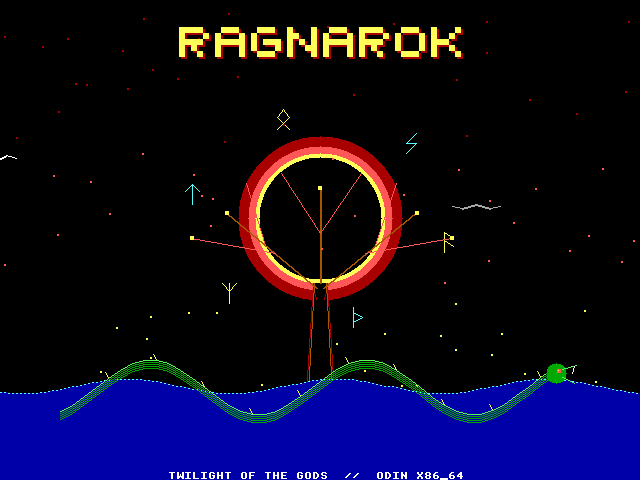

# Ragnarök



A Ring-0 x86_64 operating system written in freestanding Odin, booting directly via UEFI (OVMF) with a custom shell language.

## Quick Start

```sh
./build.sh           # Compile kernel/ + userspace/apps/ (.PRG)
./build.sh run       # Boot Ragnarök in QEMU/KVM
./build.sh usb       # Build UEFI-bootable GPT/FAT32 USB image (build/ragnarok.img)
./build.sh test      # Headless smoke test via COM1 serial
./build.sh debug     # Boot in QEMU paused with GDB stub (:1234) + LLDB/GDB helper
./build.sh asm [sym] # Disassemble kernel PE/COFF (optionally centered on symbol)
./build.sh sym       # Dump PE/PDB symbol table from BOOTX64.EFI
./build.sh log       # Tail latest build/qemu.log
```

## Architecture
- **Boot**: Direct UEFI (`freestanding_amd64_win64` + `lld-link /subsystem:efi_application`)
- **Execution & Interrupts**: Ring-0 single identity-mapped 64-bit address space, custom 64-bit GDT, 256-entry IDT with `#BP` trap and panic register dump (including active `.prg` base/offset), remapped 8259 PIC (`32..47`), `1000 Hz` PIT IRQ0 timer, and ACPI FADT/DSDT `_S5_` bare-metal poweroff
- **Diagnostics & Timing**: 16 KiB `dmesg` ring-buffer kernel logger, PIT-calibrated RDTSC microsecond profiling (`uptime`, `time`), and `selftest`
- **Memory**: UEFI memory-map 4 KiB page-frame bitmap PMM (contiguous DMA allocations) + growable 64 KiB PMM-backed Arena allocator (`context.allocator`)
- **Graphics**: Logical `640×480` 16-color indexed canvas with mutable LUT, integer-scaled to UEFI GOP
- **Storage**: Unified `Block_Device` with polling AHCI (SATA) & NVMe SSD drivers + GPT/FAT32 filesystem with LFN, `mount` (multi-disk), `mkdir`, `write`, `copy`, `move`, `del`, `rmdir`, `df`, and `list_dir`
- **Userspace `.prg` & Syscalls**: Relocatable PE32+ `.prg` executables in `/BIN/` (`exec` or bare-name lookup), dynamically loaded and relocated into PMM pages via `kernel/prg.odin` and cleanly freed on exit, sharing `kernel/syscalls/` (`alloc`, `read_file`, `write_file`, `list_dir`, graphics, RTC/PIT) with zero static kernel coupling to `userspace/`
- **Shell & Input**: Pipe shell (`|`, `"quotes"`, `# comments`, `--help`, per-stage arena cleanup) + polling xHCI (USB 3.0) with 1st-level USB hub & HID Boot keyboard support + PS/2 i8042 + COM1 UART + 80×60 console
